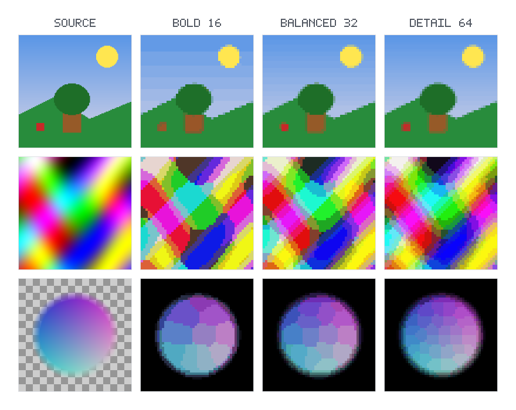

  
  

# madeitpx

`madeitpx` is a native image-processing library written in Zig with a C ABI. It
takes an RGBA8 pixel buffer, samples it onto a caller-selected output grid,
reduces the sampled colors to a limited palette, and returns an opaque RGBA8
buffer. It processes pixel buffers rather than opening image files, so decoding
and encoding are handled by the calling application.

Licensed under the [Mozilla Public License 2.0](LICENSE).

  

## Conversion

The conversion has three stages:

1. **Sampling** maps the source image to the requested output width and height.
   Nearest sampling selects a source pixel for each output pixel and is the
   default. Area sampling combines the covered source pixels, weighting color
   by alpha.
2. **Palette reduction** groups sampled colors into a palette and maps each
   output pixel to its nearest palette color.
3. **Cluster cleanup**, enabled by default, replaces isolated pixels when a
   sufficiently large group of nearby pixels has a similar color. Strong
   color differences are left alone.

Transparent pixels are composited onto the configured background before
palette reduction. The default background is black, and every output pixel has
alpha 255.

## Options

Initialize `madeitpx_options` with `madeitpx_options_init` to get the defaults,
then change the fields you need.

| Option | Behavior |
|---|---|
| `preset` | Selects a default palette limit: balanced (32), detail (64), or bold (16) colors. |
| `palette_colors` | Overrides the preset limit with a value from 2 to 64; zero uses the preset. |
| `sample_mode` | Chooses nearest or area sampling. Defaults to nearest. |
| `background_rgb` | Sets the opaque compositing color as `0xRRGGBB`. Defaults to black. |
| `cluster_cleanup` | Enables (`1`) or disables (`0`) cleanup of isolated, similar-colored pixels. Defaults to enabled. |

## C interface

The public declarations are in [`include/madeitpx.h`](include/madeitpx.h).
`madeitpx_convert_rgba8` accepts top-to-bottom RGBA8 input, its dimensions and
byte stride, the requested output dimensions, options, and a caller-provided
output buffer. The input stride may include padding; output is tightly packed.
Use `madeitpx_get_output_size` to determine the required output capacity.

The caller owns both buffers, and they must not overlap. The API reports
invalid arguments, undersized buffers, size overflow, and allocation failure
through `madeitpx_status`.

## .NET binding

The [`MadeIt.PixelArt` binding](bindings/dotnet/src/MadeIt.PixelArt) targets
.NET Framework 4.6.2, .NET Standard 2.0, .NET Standard 2.1, and .NET 10.0. Its
NuGet package includes native libraries for Windows, Linux (glibc), and macOS
on x64 and ARM64.

## Node.js binding

The [`@madeit/pixelart` package](bindings/node) wraps the native C ABI and
requires a separately built `madeitpx` shared library for the current platform
and architecture.

## Python binding

The [`madeitpx` package](bindings/python) installs with pip and includes native
libraries for Windows, Linux (glibc), and macOS on x64 and ARM64.

## Rust binding

The [`madeitpx` crate](bindings/rust) wraps the native C ABI and includes
libraries for Windows, Linux (glibc), and macOS on x64 and ARM64.

## Validation images

The [`test_sources/test-patterns`](test_sources/test-patterns) directory
contains images for checking sampling, palette limits, alpha compositing,
cleanup, and unusual dimensions. The comparisons below show each source with
every preset and sampling mode.

## Test-source results

<!-- generated-test-results:start -->

01_hue_gradient.png

<table>
<thead><tr><th>Preset</th><th>Nearest</th><th>Area</th></tr></thead>
<tbody>
<tr><th>balanced (32 colors)</th>
<td></td>
<td></td>
</tr>
<tr><th>detail (64 colors)</th>
<td></td>
<td></td>
</tr>
<tr><th>bold (16 colors)</th>
<td></td>
<td></td>
</tr>
</tbody>
</table>

02_gray_ramps.png

<table>
<thead><tr><th>Preset</th><th>Nearest</th><th>Area</th></tr></thead>
<tbody>
<tr><th>balanced (32 colors)</th>
<td></td>
<td></td>
</tr>
<tr><th>detail (64 colors)</th>
<td></td>
<td></td>
</tr>
<tr><th>bold (16 colors)</th>
<td></td>
<td></td>
</tr>
</tbody>
</table>

03_swatches_64_colors.png

<table>
<thead><tr><th>Preset</th><th>Nearest</th><th>Area</th></tr></thead>
<tbody>
<tr><th>balanced (32 colors)</th>
<td></td>
<td></td>
</tr>
<tr><th>detail (64 colors)</th>
<td></td>
<td></td>
</tr>
<tr><th>bold (16 colors)</th>
<td></td>
<td></td>
</tr>
</tbody>
</table>

04_near_duplicate_colors.png

<table>
<thead><tr><th>Preset</th><th>Nearest</th><th>Area</th></tr></thead>
<tbody>
<tr><th>balanced (32 colors)</th>
<td></td>
<td></td>
</tr>
<tr><th>detail (64 colors)</th>
<td></td>
<td></td>
</tr>
<tr><th>bold (16 colors)</th>
<td></td>
<td></td>
</tr>
</tbody>
</table>

05_alpha_ramps.png

<table>
<thead><tr><th>Preset</th><th>Nearest</th><th>Area</th></tr></thead>
<tbody>
<tr><th>balanced (32 colors)</th>
<td></td>
<td></td>
</tr>
<tr><th>detail (64 colors)</th>
<td></td>
<td></td>
</tr>
<tr><th>bold (16 colors)</th>
<td></td>
<td></td>
</tr>
</tbody>
</table>

06_alpha_soft_circle.png

<table>
<thead><tr><th>Preset</th><th>Nearest</th><th>Area</th></tr></thead>
<tbody>
<tr><th>balanced (32 colors)</th>
<td></td>
<td></td>
</tr>
<tr><th>detail (64 colors)</th>
<td></td>
<td></td>
</tr>
<tr><th>bold (16 colors)</th>
<td></td>
<td></td>
</tr>
</tbody>
</table>

07_checkerboards_1_2_4_8px.png

<table>
<thead><tr><th>Preset</th><th>Nearest</th><th>Area</th></tr></thead>
<tbody>
<tr><th>balanced (32 colors)</th>
<td></td>
<td></td>
</tr>
<tr><th>detail (64 colors)</th>
<td></td>
<td></td>
</tr>
<tr><th>bold (16 colors)</th>
<td></td>
<td></td>
</tr>
</tbody>
</table>

08_color_stripes_fine.png

<table>
<thead><tr><th>Preset</th><th>Nearest</th><th>Area</th></tr></thead>
<tbody>
<tr><th>balanced (32 colors)</th>
<td></td>
<td></td>
</tr>
<tr><th>detail (64 colors)</th>
<td></td>
<td></td>
</tr>
<tr><th>bold (16 colors)</th>
<td></td>
<td></td>
</tr>
</tbody>
</table>

09_isolated_pixels_cleanup.png

<table>
<thead><tr><th>Preset</th><th>Nearest</th><th>Area</th></tr></thead>
<tbody>
<tr><th>balanced (32 colors)</th>
<td></td>
<td></td>
</tr>
<tr><th>detail (64 colors)</th>
<td></td>
<td></td>
</tr>
<tr><th>bold (16 colors)</th>
<td></td>
<td></td>
</tr>
</tbody>
</table>

10_noisy_gradient.png

<table>
<thead><tr><th>Preset</th><th>Nearest</th><th>Area</th></tr></thead>
<tbody>
<tr><th>balanced (32 colors)</th>
<td></td>
<td></td>
</tr>
<tr><th>detail (64 colors)</th>
<td></td>
<td></td>
</tr>
<tr><th>bold (16 colors)</th>
<td></td>
<td></td>
</tr>
</tbody>
</table>

11_lines_shapes_text.png

<table>
<thead><tr><th>Preset</th><th>Nearest</th><th>Area</th></tr></thead>
<tbody>
<tr><th>balanced (32 colors)</th>
<td></td>
<td></td>
</tr>
<tr><th>detail (64 colors)</th>
<td></td>
<td></td>
</tr>
<tr><th>bold (16 colors)</th>
<td></td>
<td></td>
</tr>
</tbody>
</table>

12_scene_sprite.png

<table>
<thead><tr><th>Preset</th><th>Nearest</th><th>Area</th></tr></thead>
<tbody>
<tr><th>balanced (32 colors)</th>
<td></td>
<td></td>
</tr>
<tr><th>detail (64 colors)</th>
<td></td>
<td></td>
</tr>
<tr><th>bold (16 colors)</th>
<td></td>
<td></td>
</tr>
</tbody>
</table>

13_plasma_photo_like.png

<table>
<thead><tr><th>Preset</th><th>Nearest</th><th>Area</th></tr></thead>
<tbody>
<tr><th>balanced (32 colors)</th>
<td></td>
<td></td>
</tr>
<tr><th>detail (64 colors)</th>
<td></td>
<td></td>
</tr>
<tr><th>bold (16 colors)</th>
<td></td>
<td></td>
</tr>
</tbody>
</table>

14_extreme_colors.png

<table>
<thead><tr><th>Preset</th><th>Nearest</th><th>Area</th></tr></thead>
<tbody>
<tr><th>balanced (32 colors)</th>
<td></td>
<td></td>
</tr>
<tr><th>detail (64 colors)</th>
<td></td>
<td></td>
</tr>
<tr><th>bold (16 colors)</th>
<td></td>
<td></td>
</tr>
</tbody>
</table>

15_odd_size_1000x3.png

<table>
<thead><tr><th>Preset</th><th>Nearest</th><th>Area</th></tr></thead>
<tbody>
<tr><th>balanced (32 colors)</th>
<td></td>
<td></td>
</tr>
<tr><th>detail (64 colors)</th>
<td></td>
<td></td>
</tr>
<tr><th>bold (16 colors)</th>
<td></td>
<td></td>
</tr>
</tbody>
</table>

15_odd_size_100x1.png

<table>
<thead><tr><th>Preset</th><th>Nearest</th><th>Area</th></tr></thead>
<tbody>
<tr><th>balanced (32 colors)</th>
<td></td>
<td></td>
</tr>
<tr><th>detail (64 colors)</th>
<td></td>
<td></td>
</tr>
<tr><th>bold (16 colors)</th>
<td></td>
<td></td>
</tr>
</tbody>
</table>

15_odd_size_1x1.png

<table>
<thead><tr><th>Preset</th><th>Nearest</th><th>Area</th></tr></thead>
<tbody>
<tr><th>balanced (32 colors)</th>
<td></td>
<td></td>
</tr>
<tr><th>detail (64 colors)</th>
<td></td>
<td></td>
</tr>
<tr><th>bold (16 colors)</th>
<td></td>
<td></td>
</tr>
</tbody>
</table>

15_odd_size_1x100.png

<table>
<thead><tr><th>Preset</th><th>Nearest</th><th>Area</th></tr></thead>
<tbody>
<tr><th>balanced (32 colors)</th>
<td></td>
<td></td>
</tr>
<tr><th>detail (64 colors)</th>
<td></td>
<td></td>
</tr>
<tr><th>bold (16 colors)</th>
<td></td>
<td></td>
</tr>
</tbody>
</table>

15_odd_size_255x257.png

<table>
<thead><tr><th>Preset</th><th>Nearest</th><th>Area</th></tr></thead>
<tbody>
<tr><th>balanced (32 colors)</th>
<td></td>
<td></td>
</tr>
<tr><th>detail (64 colors)</th>
<td></td>
<td></td>
</tr>
<tr><th>bold (16 colors)</th>
<td></td>
<td></td>
</tr>
</tbody>
</table>

15_odd_size_2x2.png

<table>
<thead><tr><th>Preset</th><th>Nearest</th><th>Area</th></tr></thead>
<tbody>
<tr><th>balanced (32 colors)</th>
<td></td>
<td></td>
</tr>
<tr><th>detail (64 colors)</th>
<td></td>
<td></td>
</tr>
<tr><th>bold (16 colors)</th>
<td></td>
<td></td>
</tr>
</tbody>
</table>

15_odd_size_37x23.png

<table>
<thead><tr><th>Preset</th><th>Nearest</th><th>Area</th></tr></thead>
<tbody>
<tr><th>balanced (32 colors)</th>
<td></td>
<td></td>
</tr>
<tr><th>detail (64 colors)</th>
<td></td>
<td></td>
</tr>
<tr><th>bold (16 colors)</th>
<td></td>
<td></td>
</tr>
</tbody>
</table>

15_odd_size_7x513.png

<table>
<thead><tr><th>Preset</th><th>Nearest</th><th>Area</th></tr></thead>
<tbody>
<tr><th>balanced (32 colors)</th>
<td></td>
<td></td>
</tr>
<tr><th>detail (64 colors)</th>
<td></td>
<td></td>
</tr>
<tr><th>bold (16 colors)</th>
<td></td>
<td></td>
</tr>
</tbody>
</table>

16_alpha_checker_over_plasma.png

<table>
<thead><tr><th>Preset</th><th>Nearest</th><th>Area</th></tr></thead>
<tbody>
<tr><th>balanced (32 colors)</th>
<td></td>
<td></td>
</tr>
<tr><th>detail (64 colors)</th>
<td></td>
<td></td>
</tr>
<tr><th>bold (16 colors)</th>
<td></td>
<td></td>
</tr>
</tbody>
</table>

<!-- generated-test-results:end -->
