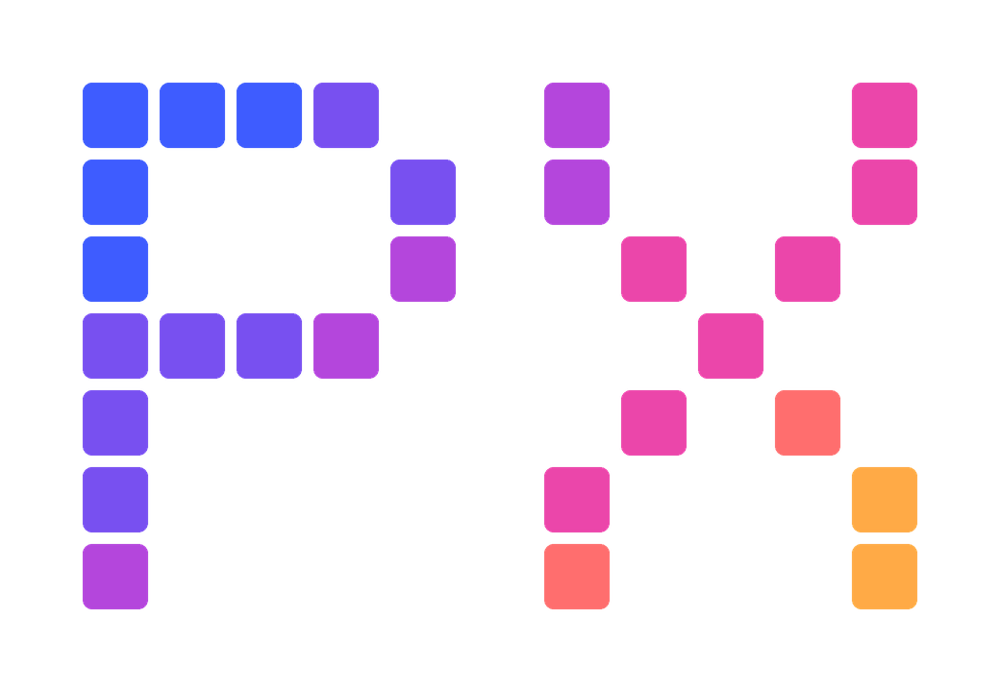
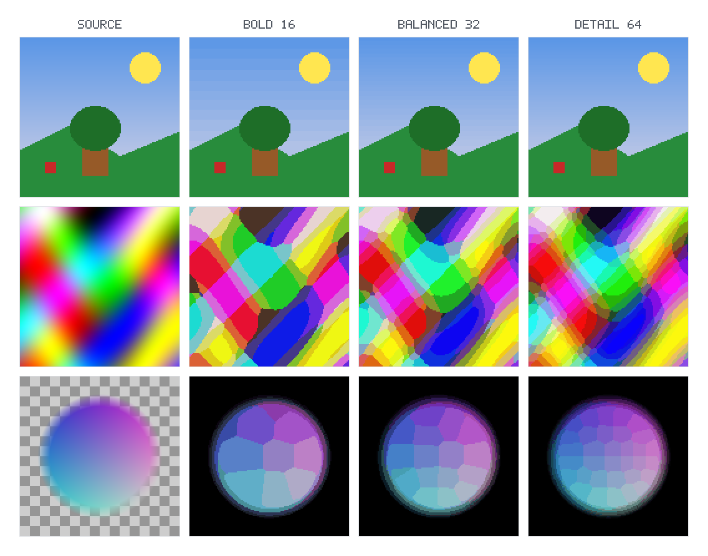

# MadeIt.PixelArt



A .NET wrapper for [madeitpx](https://github.com/TamKungZ/madeitpx), a native
library that converts RGBA8 pixel buffers to a smaller color palette and output
grid.



## Install

```shell
dotnet add package MadeIt.PixelArt
```

The NuGet package includes the native `madeitpx` library for Windows, Linux
(glibc), and macOS on x64 and ARM64. NuGet selects the native library matching
the application's runtime identifier.

## Convert an image buffer

Pass decoded RGBA8 pixels, their dimensions and row stride, and the desired
output dimensions:

```csharp
using MadeIt.PixelArt;

byte[] rgba = GetRgbaPixels();
byte[] result = PixelArtConverter.Convert(
    rgba,
    inputWidth: 256,
    inputHeight: 256,
    inputStride: 256 * 4,
    targetWidth: 64,
    targetHeight: 64);
```

`result` is tightly packed RGBA8 with opaque pixels. The wrapper does not
decode or encode image files.

Pass `ConversionOptions` to set a preset or palette size, choose area or nearest
sampling, set the compositing background (`0xRRGGBB`), or disable cluster
cleanup. Defaults are balanced palette, nearest sampling, black background,
and cleanup enabled.

## Target frameworks

`net462`, `netstandard2.0`, `netstandard2.1`, and `net10.0`. Native assets are
provided for `win-x64`, `win-arm64`, `linux-x64`, `linux-arm64`, `osx-x64`,
and `osx-arm64`.

Licensed under [MPL-2.0](https://mozilla.org/MPL/2.0/).
