# Pixel-art conversion results

Generated with `python tests/render_patterns.py` from the official test-pattern corpus.
Square patterns use a 128x128 output grid; odd-size patterns use their source grid.

01_hue_gradient.png

<table>
<thead><tr><th>Preset</th><th>Nearest</th><th>Area</th></tr></thead>
<tbody>
<tr><th>balanced (32 colors)</th>
<td><a href="01_hue_gradient--balanced-nearest.png">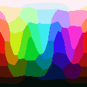</a></td>
<td><a href="01_hue_gradient--balanced-area.png">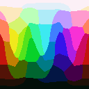</a></td>
</tr>
<tr><th>detail (64 colors)</th>
<td><a href="01_hue_gradient--detail-nearest.png">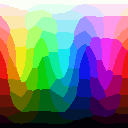</a></td>
<td><a href="01_hue_gradient--detail-area.png">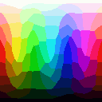</a></td>
</tr>
<tr><th>bold (16 colors)</th>
<td><a href="01_hue_gradient--bold-nearest.png">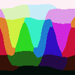</a></td>
<td><a href="01_hue_gradient--bold-area.png">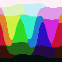</a></td>
</tr>
</tbody>
</table>

02_gray_ramps.png

<table>
<thead><tr><th>Preset</th><th>Nearest</th><th>Area</th></tr></thead>
<tbody>
<tr><th>balanced (32 colors)</th>
<td><a href="02_gray_ramps--balanced-nearest.png">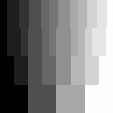</a></td>
<td></td>
</tr>
<tr><th>detail (64 colors)</th>
<td><a href="02_gray_ramps--detail-nearest.png">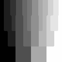</a></td>
<td></td>
</tr>
<tr><th>bold (16 colors)</th>
<td></td>
<td><a href="02_gray_ramps--bold-area.png">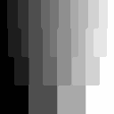</a></td>
</tr>
</tbody>
</table>

03_swatches_64_colors.png

<table>
<thead><tr><th>Preset</th><th>Nearest</th><th>Area</th></tr></thead>
<tbody>
<tr><th>balanced (32 colors)</th>
<td></td>
<td><a href="03_swatches_64_colors--balanced-area.png">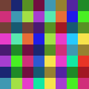</a></td>
</tr>
<tr><th>detail (64 colors)</th>
<td></td>
<td><a href="03_swatches_64_colors--detail-area.png">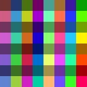</a></td>
</tr>
<tr><th>bold (16 colors)</th>
<td><a href="03_swatches_64_colors--bold-nearest.png">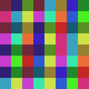</a></td>
<td></td>
</tr>
</tbody>
</table>

04_near_duplicate_colors.png

<table>
<thead><tr><th>Preset</th><th>Nearest</th><th>Area</th></tr></thead>
<tbody>
<tr><th>balanced (32 colors)</th>
<td></td>
<td><a href="04_near_duplicate_colors--balanced-area.png">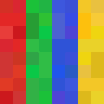</a></td>
</tr>
<tr><th>detail (64 colors)</th>
<td><a href="04_near_duplicate_colors--detail-nearest.png">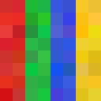</a></td>
<td></td>
</tr>
<tr><th>bold (16 colors)</th>
<td><a href="04_near_duplicate_colors--bold-nearest.png">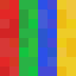</a></td>
<td></td>
</tr>
</tbody>
</table>

05_alpha_ramps.png

<table>
<thead><tr><th>Preset</th><th>Nearest</th><th>Area</th></tr></thead>
<tbody>
<tr><th>balanced (32 colors)</th>
<td><a href="05_alpha_ramps--balanced-nearest.png">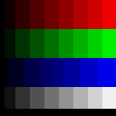</a></td>
<td></td>
</tr>
<tr><th>detail (64 colors)</th>
<td></td>
<td><a href="05_alpha_ramps--detail-area.png">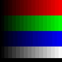</a></td>
</tr>
<tr><th>bold (16 colors)</th>
<td></td>
<td><a href="05_alpha_ramps--bold-area.png">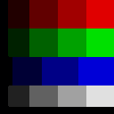</a></td>
</tr>
</tbody>
</table>

06_alpha_soft_circle.png

<table>
<thead><tr><th>Preset</th><th>Nearest</th><th>Area</th></tr></thead>
<tbody>
<tr><th>balanced (32 colors)</th>
<td></td>
<td></td>
</tr>
<tr><th>detail (64 colors)</th>
<td></td>
<td></td>
</tr>
<tr><th>bold (16 colors)</th>
<td></td>
<td></td>
</tr>
</tbody>
</table>

07_checkerboards_1_2_4_8px.png

<table>
<thead><tr><th>Preset</th><th>Nearest</th><th>Area</th></tr></thead>
<tbody>
<tr><th>balanced (32 colors)</th>
<td></td>
<td></td>
</tr>
<tr><th>detail (64 colors)</th>
<td><a href="07_checkerboards_1_2_4_8px--detail-nearest.png">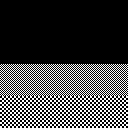</a></td>
<td></td>
</tr>
<tr><th>bold (16 colors)</th>
<td></td>
<td><a href="07_checkerboards_1_2_4_8px--bold-area.png">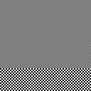</a></td>
</tr>
</tbody>
</table>

08_color_stripes_fine.png

<table>
<thead><tr><th>Preset</th><th>Nearest</th><th>Area</th></tr></thead>
<tbody>
<tr><th>balanced (32 colors)</th>
<td></td>
<td><a href="08_color_stripes_fine--balanced-area.png">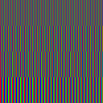</a></td>
</tr>
<tr><th>detail (64 colors)</th>
<td></td>
<td></td>
</tr>
<tr><th>bold (16 colors)</th>
<td><a href="08_color_stripes_fine--bold-nearest.png">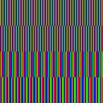</a></td>
<td></td>
</tr>
</tbody>
</table>

09_isolated_pixels_cleanup.png

<table>
<thead><tr><th>Preset</th><th>Nearest</th><th>Area</th></tr></thead>
<tbody>
<tr><th>balanced (32 colors)</th>
<td><a href="09_isolated_pixels_cleanup--balanced-nearest.png">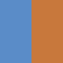</a></td>
<td><a href="09_isolated_pixels_cleanup--balanced-area.png">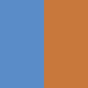</a></td>
</tr>
<tr><th>detail (64 colors)</th>
<td></td>
<td></td>
</tr>
<tr><th>bold (16 colors)</th>
<td><a href="09_isolated_pixels_cleanup--bold-nearest.png">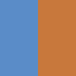</a></td>
<td><a href="09_isolated_pixels_cleanup--bold-area.png">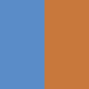</a></td>
</tr>
</tbody>
</table>

10_noisy_gradient.png

<table>
<thead><tr><th>Preset</th><th>Nearest</th><th>Area</th></tr></thead>
<tbody>
<tr><th>balanced (32 colors)</th>
<td><a href="10_noisy_gradient--balanced-nearest.png">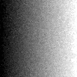</a></td>
<td></td>
</tr>
<tr><th>detail (64 colors)</th>
<td><a href="10_noisy_gradient--detail-nearest.png">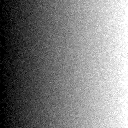</a></td>
<td></td>
</tr>
<tr><th>bold (16 colors)</th>
<td></td>
<td><a href="10_noisy_gradient--bold-area.png">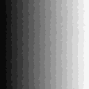</a></td>
</tr>
</tbody>
</table>

11_lines_shapes_text.png

<table>
<thead><tr><th>Preset</th><th>Nearest</th><th>Area</th></tr></thead>
<tbody>
<tr><th>balanced (32 colors)</th>
<td></td>
<td></td>
</tr>
<tr><th>detail (64 colors)</th>
<td><a href="11_lines_shapes_text--detail-nearest.png">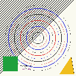</a></td>
<td></td>
</tr>
<tr><th>bold (16 colors)</th>
<td></td>
<td></td>
</tr>
</tbody>
</table>

12_scene_sprite.png

<table>
<thead><tr><th>Preset</th><th>Nearest</th><th>Area</th></tr></thead>
<tbody>
<tr><th>balanced (32 colors)</th>
<td></td>
<td></td>
</tr>
<tr><th>detail (64 colors)</th>
<td></td>
<td><a href="12_scene_sprite--detail-area.png">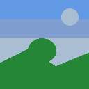</a></td>
</tr>
<tr><th>bold (16 colors)</th>
<td><a href="12_scene_sprite--bold-nearest.png">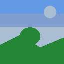</a></td>
<td></td>
</tr>
</tbody>
</table>

13_plasma_photo_like.png

<table>
<thead><tr><th>Preset</th><th>Nearest</th><th>Area</th></tr></thead>
<tbody>
<tr><th>balanced (32 colors)</th>
<td><a href="13_plasma_photo_like--balanced-nearest.png">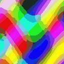</a></td>
<td><a href="13_plasma_photo_like--balanced-area.png">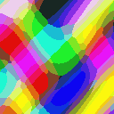</a></td>
</tr>
<tr><th>detail (64 colors)</th>
<td></td>
<td><a href="13_plasma_photo_like--detail-area.png">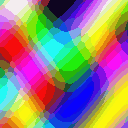</a></td>
</tr>
<tr><th>bold (16 colors)</th>
<td><a href="13_plasma_photo_like--bold-nearest.png">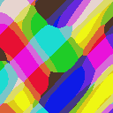</a></td>
<td><a href="13_plasma_photo_like--bold-area.png">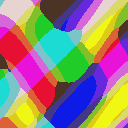</a></td>
</tr>
</tbody>
</table>

14_extreme_colors.png

<table>
<thead><tr><th>Preset</th><th>Nearest</th><th>Area</th></tr></thead>
<tbody>
<tr><th>balanced (32 colors)</th>
<td></td>
<td><a href="14_extreme_colors--balanced-area.png">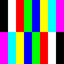</a></td>
</tr>
<tr><th>detail (64 colors)</th>
<td></td>
<td></td>
</tr>
<tr><th>bold (16 colors)</th>
<td></td>
<td></td>
</tr>
</tbody>
</table>

15_odd_size_1000x3.png

<table>
<thead><tr><th>Preset</th><th>Nearest</th><th>Area</th></tr></thead>
<tbody>
<tr><th>balanced (32 colors)</th>
<td></td>
<td><a href="15_odd_size_1000x3--balanced-area.png">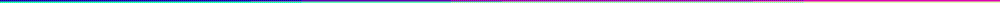</a></td>
</tr>
<tr><th>detail (64 colors)</th>
<td></td>
<td><a href="15_odd_size_1000x3--detail-area.png">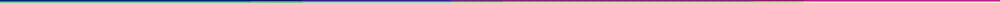</a></td>
</tr>
<tr><th>bold (16 colors)</th>
<td></td>
<td></td>
</tr>
</tbody>
</table>

15_odd_size_100x1.png

<table>
<thead><tr><th>Preset</th><th>Nearest</th><th>Area</th></tr></thead>
<tbody>
<tr><th>balanced (32 colors)</th>
<td></td>
<td></td>
</tr>
<tr><th>detail (64 colors)</th>
<td></td>
<td></td>
</tr>
<tr><th>bold (16 colors)</th>
<td></td>
<td></td>
</tr>
</tbody>
</table>

15_odd_size_1x1.png

<table>
<thead><tr><th>Preset</th><th>Nearest</th><th>Area</th></tr></thead>
<tbody>
<tr><th>balanced (32 colors)</th>
<td></td>
<td></td>
</tr>
<tr><th>detail (64 colors)</th>
<td></td>
<td></td>
</tr>
<tr><th>bold (16 colors)</th>
<td></td>
<td></td>
</tr>
</tbody>
</table>

15_odd_size_1x100.png

<table>
<thead><tr><th>Preset</th><th>Nearest</th><th>Area</th></tr></thead>
<tbody>
<tr><th>balanced (32 colors)</th>
<td></td>
<td></td>
</tr>
<tr><th>detail (64 colors)</th>
<td></td>
<td></td>
</tr>
<tr><th>bold (16 colors)</th>
<td></td>
<td></td>
</tr>
</tbody>
</table>

15_odd_size_255x257.png

<table>
<thead><tr><th>Preset</th><th>Nearest</th><th>Area</th></tr></thead>
<tbody>
<tr><th>balanced (32 colors)</th>
<td></td>
<td><a href="15_odd_size_255x257--balanced-area.png">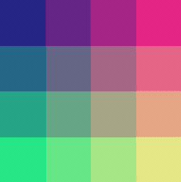</a></td>
</tr>
<tr><th>detail (64 colors)</th>
<td><a href="15_odd_size_255x257--detail-nearest.png">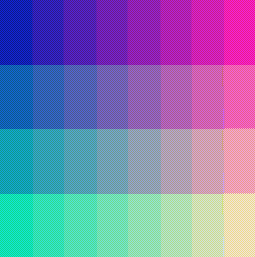</a></td>
<td></td>
</tr>
<tr><th>bold (16 colors)</th>
<td></td>
<td><a href="15_odd_size_255x257--bold-area.png">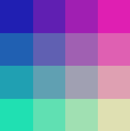</a></td>
</tr>
</tbody>
</table>

15_odd_size_2x2.png

<table>
<thead><tr><th>Preset</th><th>Nearest</th><th>Area</th></tr></thead>
<tbody>
<tr><th>balanced (32 colors)</th>
<td></td>
<td></td>
</tr>
<tr><th>detail (64 colors)</th>
<td></td>
<td></td>
</tr>
<tr><th>bold (16 colors)</th>
<td><a href="15_odd_size_2x2--bold-nearest.png">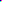</a></td>
<td></td>
</tr>
</tbody>
</table>

15_odd_size_37x23.png

<table>
<thead><tr><th>Preset</th><th>Nearest</th><th>Area</th></tr></thead>
<tbody>
<tr><th>balanced (32 colors)</th>
<td><a href="15_odd_size_37x23--balanced-nearest.png">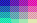</a></td>
<td></td>
</tr>
<tr><th>detail (64 colors)</th>
<td></td>
<td></td>
</tr>
<tr><th>bold (16 colors)</th>
<td><a href="15_odd_size_37x23--bold-nearest.png">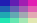</a></td>
<td></td>
</tr>
</tbody>
</table>

15_odd_size_7x513.png

<table>
<thead><tr><th>Preset</th><th>Nearest</th><th>Area</th></tr></thead>
<tbody>
<tr><th>balanced (32 colors)</th>
<td></td>
<td><a href="15_odd_size_7x513--balanced-area.png">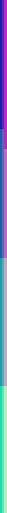</a></td>
</tr>
<tr><th>detail (64 colors)</th>
<td></td>
<td><a href="15_odd_size_7x513--detail-area.png">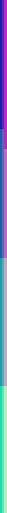</a></td>
</tr>
<tr><th>bold (16 colors)</th>
<td><a href="15_odd_size_7x513--bold-nearest.png">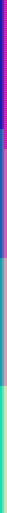</a></td>
<td></td>
</tr>
</tbody>
</table>

16_alpha_checker_over_plasma.png

<table>
<thead><tr><th>Preset</th><th>Nearest</th><th>Area</th></tr></thead>
<tbody>
<tr><th>balanced (32 colors)</th>
<td><a href="16_alpha_checker_over_plasma--balanced-nearest.png">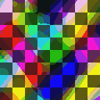</a></td>
<td></td>
</tr>
<tr><th>detail (64 colors)</th>
<td></td>
<td></td>
</tr>
<tr><th>bold (16 colors)</th>
<td></td>
<td></td>
</tr>
</tbody>
</table>

